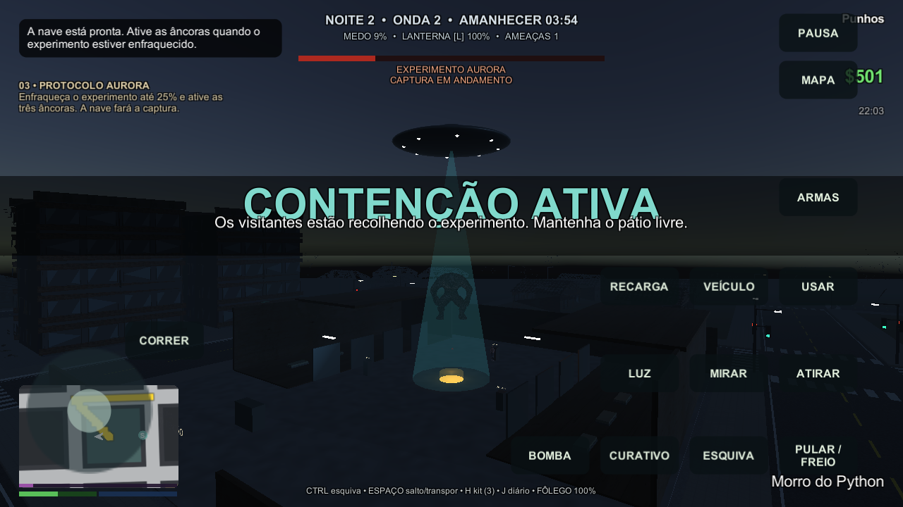
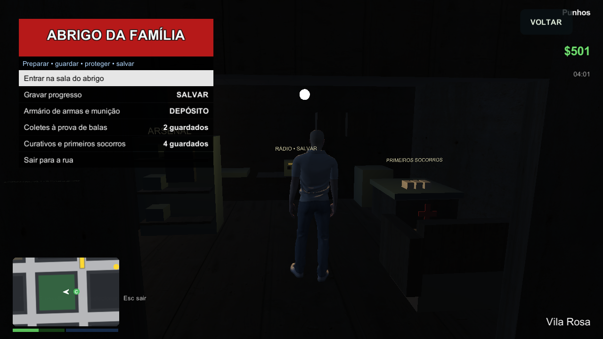

# Dev City — Última Noite

Esta página descreve a revisão local em desenvolvimento. A documentação é publicada separadamente; o repositório ainda não contém todas as alterações e assets da cópia local, e os builds não são distribuídos por este README.

Jogo de terror e sobrevivência em terceira pessoa dentro de Dev City. Você acorda no abrigo destruído e procura Helena e Lia, sua família, enquanto investiga o acidente que tomou a cidade. Carros e motos continuam utilizáveis, com portas, danos na lataria e atropelamentos.

## História e objetivos

1. **Sem Sinal:** encontre o fusível da oficina, decifre os relés e defenda o gerador do abrigo.
2. **Último Comboio:** investigue o registro do hospital, resgate Helena e Lia e leve as duas de carro ao abrigo.
3. **Protocolo Aurora:** encontre a equipe extraterrestre no Hospital Psiquiátrico Santa Aurora. Os visitantes vieram ajudar: o gigante é um experimento humano que rompeu a contenção. Investigue a mansão do Dr. Mota, resolva as válvulas ou arrombe o portão, busque dois estabilizadores e decifre o prontuário. Destrua os ninhos do Hospital Central, enfraqueça o experimento até 25% e ative três âncoras para a nave capturá-lo vivo.
4. **O Carrasco:** enfrente o guardião da transmissão perto da delegacia.
5. **O Último Sinal:** resolva a matriz do emissor e encerre as ondas. A família se reúne e o dia retorna; a exploração continua.

As naves recolhem civis para resgate e quarentena. Cães contaminados protegem a mansão; a passagem de serviço oferece outra aproximação. Espíritos, palhaços, psicopatas, rastejantes, monstros e zumbis mantêm comportamentos distintos. O diário reúne as pistas encontradas.

## Imagens da revisão local

Capturas reais do autotest; a interface de toque está habilitada nas imagens desta revisão.

## Abrigo, suprimentos e combate

A casa possui quarto, sala, cozinha, rádio para salvar, armário de armas e bancada médica. Guarde e retire armas com a respectiva munição; transfira curativos e retire coletes do estoque limitado. O progresso e o estoque são salvos juntos.

Lojas vendem munição, armas, curativos, coletes e cargas remotas. Durante a noite há atendimento de emergência na loja de armas. Uma carga permite abrir o portão da mansão, mas atrai cães. Atropelamentos causam dano e deixam marcas temporárias de sangue e pneus; o sistema limita a quantidade de marcas para controlar o custo.

Noites longas, neblina, lua fria, postes oscilantes, árvores secas e fachadas abandonadas compõem o ambiente. Os sons de vento, passos, rádio, coração, rugidos e impactos são sintetizados pelo jogo. Os prédios e interiores ainda usam geometria simples com materiais fotográficos; a arte continua em desenvolvimento.

## Como jogar no Windows

Na cópia local de desenvolvimento, execute **Build/Revisao/DevCityV.exe** para a revisão mais recente. **Build/DevCityV.exe** pode estar numa revisão anterior enquanto uma partida estiver aberta. Não mova somente o executável: mantenha a pasta de dados, UnityPlayer.dll e Licencas ao lado dele.

O jogo inicia na cidade sem argumentos. Clique na tela de título ou pressione Enter. Uma partida nova começa com o despertar no abrigo. Saves anteriores continuam a campanha no ponto já concluído; o prólogo não é repetido automaticamente.

| Controle | Ação |
|---|---|
| WASD / mouse | Andar, dirigir e olhar |
| Shift / Ctrl / Espaço | Correr / esquivar / saltar ou freio de mão |
| F | Entrar e sair do veículo |
| E | Interagir; segurar em objetivos; buzina no carro |
| Botão direito / esquerdo | Mirar / atirar |
| R | Recarregar |
| Tab segurado | Abrir carrossel; roda ou setas escolhem; solte para equipar |
| 1–7 / roda | Trocar arma |
| B | Instalar carga; B novamente detona |
| H | Usar curativo a pé; faróis no carro |
| L / J / M | Lanterna / diário / mapa |
| Esc | Pausa com Continuar, Mapa, Salvar e Sair |

O curativo portátil leva 1,8 segundo; movimento ou dano interrompe o uso sem consumir o item. Preserve o fôlego para esquivar das investidas anunciadas pelos chefes.

## Android e navegador

Os controles por toque incluem analógico, arraste para câmera, ações e seleção de armas. O botão VOLTAR fecha diário, enigmas, lojas e mapa. Para inspecionar o layout no Windows, use -touchcontrols.

Os alvos de saída são **Build/Android/DevCityV.apk** e **Build/Web/**. A disponibilidade e a validação de cada pacote serão registradas em MELHORIAS.md; a existência dos métodos de build não significa que os pacotes foram gerados ou testados em aparelho.

O APK de desenvolvimento usa ARM64, orientação horizontal e save no diretório persistente do aplicativo. A versão web salva por PlayerPrefs/IndexedDB, vinculada à origem do site; limpar os dados do navegador apaga esse progresso. A web precisa ser servida por HTTP/HTTPS, sem abrir index.html diretamente pelo sistema de arquivos. Com Node.js instalado, execute `node Ferramentas/servir-web.mjs` na raiz e abra http://127.0.0.1:8080.

## Compilar a partir do projeto

Use **Unity 6000.6.5f1** e a cena Assets/Scenes/DevCity.unity. Feche o Editor deste projeto antes da compilação pela linha de comando. As saídas ficam em Build/; **Build/Teste e seu save são reservados ao usuário**.

~~~powershell
$unity = 'C:/Program Files/Unity/Hub/Editor/6000.6.5f1/Editor/Unity.exe'
& $unity -batchmode -quit -nographics -projectPath 'C:/Projetos/DevCityV' -executeMethod DevCity.EditorTools.BuildTools.BuildPreviewWindows -logFile 'C:/Projetos/DevCityV/Logs/build-windows.log'
# Com os módulos oficiais correspondentes instalados:
& $unity -batchmode -quit -nographics -buildTarget Android -projectPath 'C:/Projetos/DevCityV' -executeMethod DevCity.EditorTools.PlatformBuildTools.BuildAndroid -logFile 'C:/Projetos/DevCityV/Logs/build-android.log'
& $unity -batchmode -quit -nographics -buildTarget WebGL -projectPath 'C:/Projetos/DevCityV' -executeMethod DevCity.EditorTools.PlatformBuildTools.BuildWeb -logFile 'C:/Projetos/DevCityV/Logs/build-web.log'
~~~

**Assets externos:** este repositório de desenvolvimento não inclui todos os arquivos pesados da cópia local nem os FBX originais do Mixamo. Um clone limpo pode precisar preparar os personagens, veículos e cenários pelos importadores de Assets/Editor. Consulte os arquivos LICENCA-* e os tutoriais antes de baixar e importar as fontes. Os direitos sobre Mixamo não autorizam republicar os arquivos brutos como biblioteca de assets.

## Validação

~~~powershell
& './Build/Revisao/DevCityV.exe' -autotest -terroronly -screen-width 1280 -screen-height 720 -screen-fullscreen 0 -logFile 'C:/Projetos/DevCityV/Logs/autotest.log'
~~~

- -autotest: regressão completa, incluindo carros, motos, portas, amassados, física e campanha.
- -autotest -terroronly: ameaças, armas, puzzles, história, abrigo, operação e captura.
- -autotest -terrorjogo: configuração normal, população, ausência da polícia e horda.
- -autotest -fpsonly: medição de desempenho; compare builds alternados em 720p com o mesmo save.

A meta é **FIM | erros 0 | exceções 0**. Fotos e logs ficam na pasta de saída e em Logs/. As medidas antigas de 44–54 FPS pertencem à revisão anterior à ampliação do abrigo e da operação. A revisão ampliada apresentou queda em medições preliminares na Intel HD 4000; não considere o desempenho aprovado sem consultar os resultados atuais de [MELHORIAS.md](MELHORIAS.md).

## Autores e licenças

**CC BY 4.0, personagens originais:** mizahad_Dev (palhaço), Zajjj_ (possuída), 3dmodelsst (psicopata e Carrasco), oscar_creativo (monstro e zumbi), wojciechmiedziocha (rastejante), Purple.Point (dama). Fontes e adaptações: [LICENCA-Terror.txt](Assets/Terror/LICENCA-Terror.txt).

**CC0, novos personagens:** [Giant Mutant por Eldritch Grim](https://opengameart.org/content/giant-mutant), adaptado como Experimento Aurora, com animações nativas e LODs; [Wolf por tomek](https://opengameart.org/content/3d-wolf-animation-for-game), usando a opção CC0 oferecida pelo autor, adaptado como cão contaminado. O boss da HATOGAME sugerido não foi utilizado devido à licença Editorial.

**CC0, cenário Poly Haven:** Rico Cilliers (Tree Small 02), Rob Tuytel e Dimitrios Savva (Brick Wall 001), Dario Barresi e Charlotte Baglioni (Concrete Wall 006), Rob Tuytel (Old Planks 02). Powered by Poly Haven. Fontes: [LICENCA-Cenario.txt](Assets/Terror/LICENCA-Cenario.txt). Geometria original de interiores, mansões, hospital e visitantes: CC0.

**Veículos CC BY 4.0:** Daniel Zhabotinsky; comrade1280, Alexios_Apokaukos, Alex.Ka. e graphix. Kenney, Quaternius, Mixamo e demais autores anteriores permanecem creditados em [README-CLASSICO.md](README-CLASSICO.md) e nos arquivos LICENCA-* dos assets. As atribuições acompanham os builds em Licencas e aparecem no título. Nenhum personagem cinematográfico foi adicionado.

## Documentação do projeto

[Tutorial de terror](TUTORIAL-TERROR.md) · [Veículos](TUTORIAL-VEICULOS.md) · [Resultados e limites](MELHORIAS.md) · [Relatório de continuidade](PROXIMOS-PASSOS-TERROR.md)
